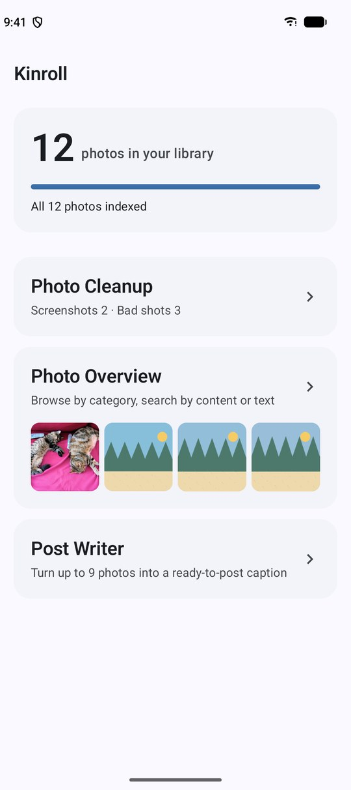
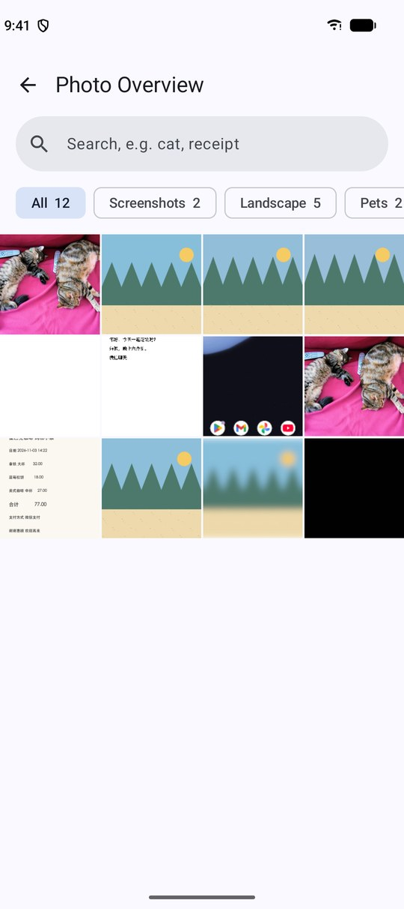
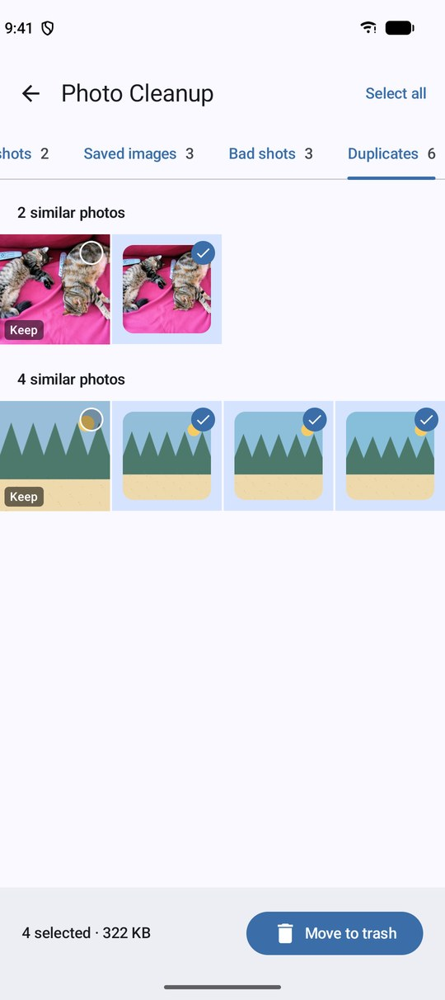
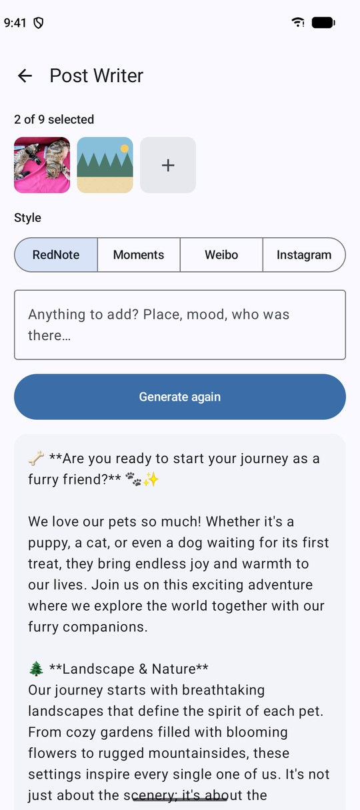

# Kinroll

English · [中文](./README.zh.md)


An AI-powered, fully offline photo album management app.

## Features

- Screenshot & saved-image cleanup
- Duplicate detection
- Bad shot cleanup
- Smart categories
- Natural language search
- One-tap post creation

## Screenshots

<p>
  
  
  
  
</p>

## How it works

Kotlin Multiplatform + Compose Multiplatform for Android 11+ and iOS 17+. Every model runs on the device:

| Task | Model | Runtime |
|---|---|---|
| Categories, search, bad-shot scoring | MobileCLIP-S2 (ONNX) | ONNX Runtime |
| Text in screenshots and documents | PP-OCRv6 small (ONNX) | ONNX Runtime |
| Post writing, translating Chinese search queries | Qwen3.5 0.8B UD-Q4_K_XL (GGUF) | llama.cpp b12121 |

The models (about 989 MB) are not bundled. On first launch the app downloads them once from Hugging Face, hf-mirror or ModelScope; after that it works offline. Deleting photos moves them to the system trash ("Recently Deleted" on iOS).

## Building

Requirements:

- JDK 21 or newer
- Android SDK: `platforms;android-37.2`, `build-tools;36.0.0`, `ndk;30.0.16248370`, `cmake;4.1.2`
- For iOS: macOS with Xcode 27 and `xcodegen`; CMake on `PATH` (used once to build the llama.cpp simulator slice)

```sh
git submodule update --init --recursive   # third_party/llama.cpp at tag b12121

./gradlew :androidApp:assembleDebug       # debug APK
scripts/build-apk.sh                      # dist/Kinroll-<VERSION>.apk (release, debug-signed)

scripts/gen-ios-project.sh                # fetches llama.xcframework, generates iosApp/Kinroll.xcodeproj
scripts/build-ipa.sh                      # dist/Kinroll-<VERSION>-unsigned.ipa
```

The official llama.cpp b12121 XCFramework has no iOS Simulator slice. `scripts/fetch-llama.sh` keeps the checksum-verified device binary and builds an arm64 simulator slice from the same tag; `scripts/build-ipa.sh` skips that step.

Tests: `./gradlew :shared:allTests` (Android host and iOS simulator).

Pushing a `v*` tag runs `.github/workflows/release.yml`, which builds the APK and the unsigned IPA and attaches both to a GitHub release.

## License

Source-available under the [PolyForm Noncommercial License 1.0.0](./LICENSE). Personal, educational and other noncommercial use, modification and redistribution are allowed. Any commercial use — selling the app or derivatives, publishing it to app stores for payment, bundling it with ads or paid services — requires a separate license from the author.

The name "Kinroll" / "相知" and the app icon are not licensed for use in derivative works.

Third-party components keep their own licenses, e.g. [llama.cpp](https://github.com/ggml-org/llama.cpp/blob/master/LICENSE) (MIT).
