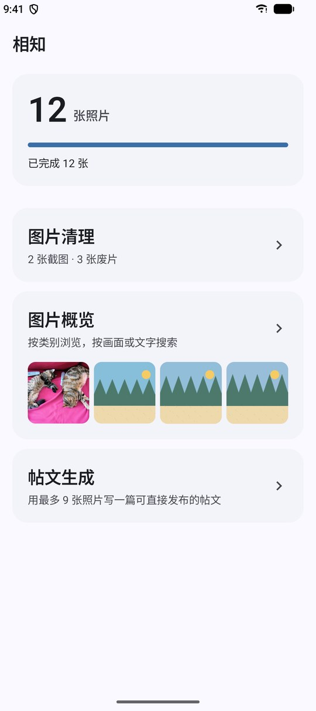
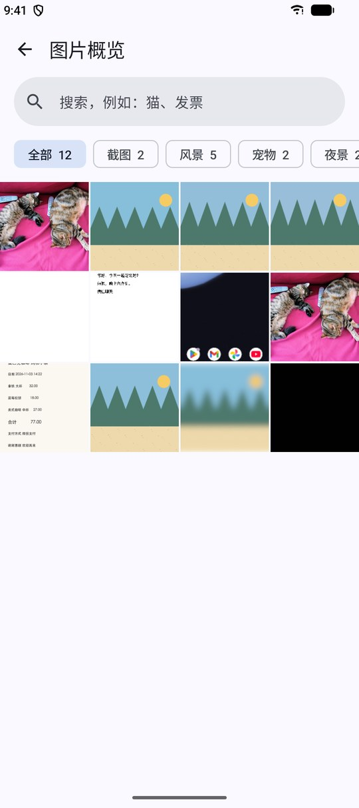
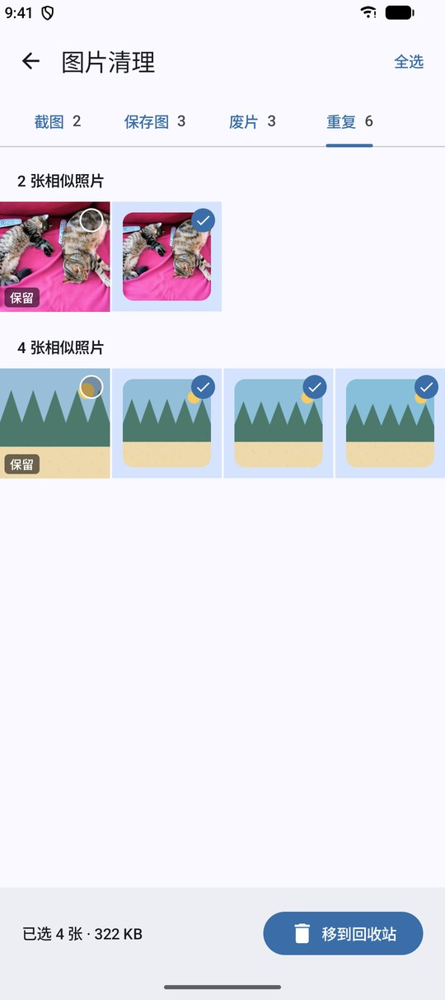
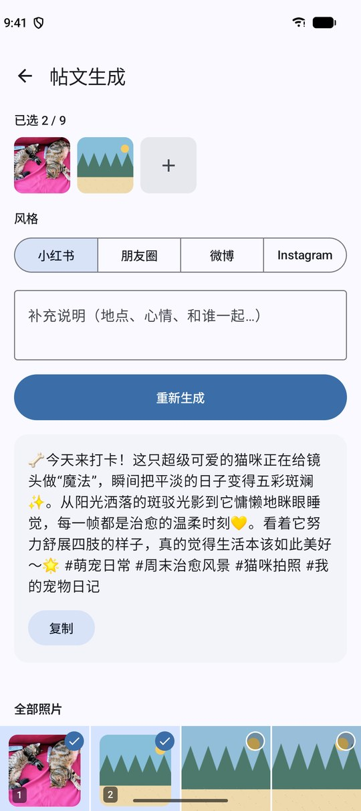

# 相知

[English](./README.md) · 中文


由人工智能驱动的完全离线的相册管理应用。

## 功能

- 截图与保存图片清理
- 重复图片检测
- 废片清理
- 智能分类
- 自然语言检索
- 一键生成帖子

## 截图

<p>
  
  
  
  
</p>

## 实现

Kotlin Multiplatform + Compose Multiplatform，支持 Android 11+ 与 iOS 17+。所有模型都在设备上运行：

| 用途 | 模型 | 运行时 |
|---|---|---|
| 分类、检索、废片判断 | MobileCLIP-S2（ONNX） | ONNX Runtime |
| 截图与文档中的文字 | PP-OCRv6 small（ONNX） | ONNX Runtime |
| 帖文生成、中文搜索词翻译 | Qwen3.5 0.8B UD-Q4_K_XL（GGUF） | llama.cpp b12121 |

模型（约 989 MB）不随安装包分发。首次启动时从 Hugging Face、hf-mirror 或 ModelScope 下载一次，之后完全离线。删除照片会移入系统回收站（iOS 为“最近删除”）。

## 构建

环境要求：

- JDK 21 或更新版本
- Android SDK：`platforms;android-37.2`、`build-tools;36.0.0`、`ndk;30.0.16248370`、`cmake;4.1.2`
- iOS：macOS + Xcode 27 + `xcodegen`；`PATH` 中需有 CMake（首次构建 llama.cpp 模拟器切片时使用）

```sh
git submodule update --init --recursive   # third_party/llama.cpp，tag b12121

./gradlew :androidApp:assembleDebug       # 调试 APK
scripts/build-apk.sh                      # dist/Kinroll-<VERSION>.apk（release，debug 签名）

scripts/gen-ios-project.sh                # 获取 llama.xcframework 并生成 iosApp/Kinroll.xcodeproj
scripts/build-ipa.sh                      # dist/Kinroll-<VERSION>-unsigned.ipa
```

llama.cpp b12121 官方 XCFramework 不含 iOS 模拟器切片。`scripts/fetch-llama.sh` 保留校验过的官方真机二进制，并从同一 tag 构建 arm64 模拟器切片；`scripts/build-ipa.sh` 会跳过这一步。

测试：`./gradlew :shared:allTests`（Android host 与 iOS 模拟器）。

推送 `v*` tag 会触发 `.github/workflows/release.yml`，构建 APK 与未签名 IPA 并上传到 GitHub Release。

## 许可证

源码以 [PolyForm Noncommercial License 1.0.0](./LICENSE) 公开。允许个人、学习等非商业用途的使用、修改和再分发。任何商业用途（出售本应用或其衍生作品、在应用商店付费上架、加入广告或付费服务等）都需要另行取得作者授权。

“相知” / “Kinroll” 名称及应用图标不授权用于衍生作品。

第三方组件遵循各自的许可证，例如 [llama.cpp](https://github.com/ggml-org/llama.cpp/blob/master/LICENSE)（MIT）。
